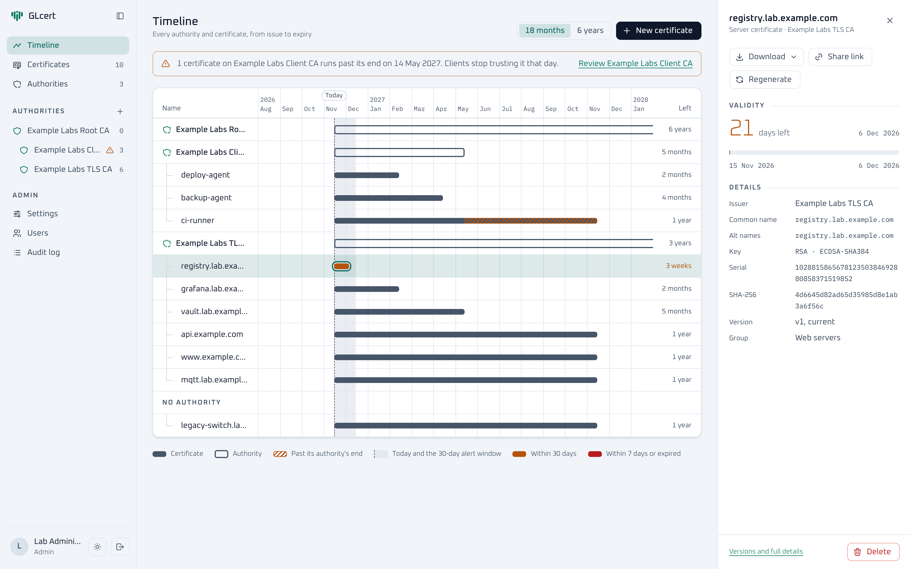
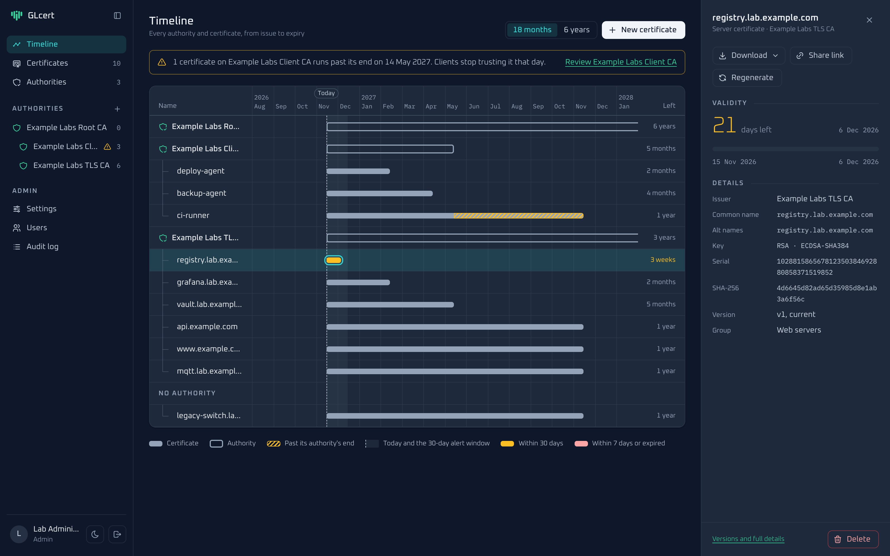
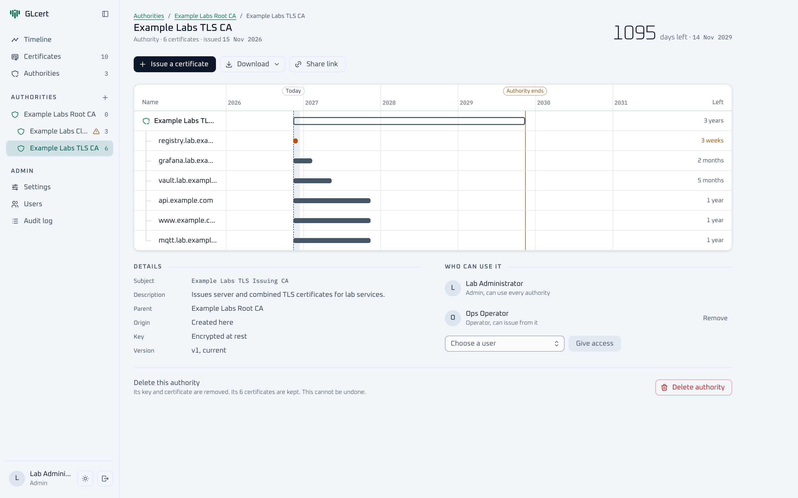
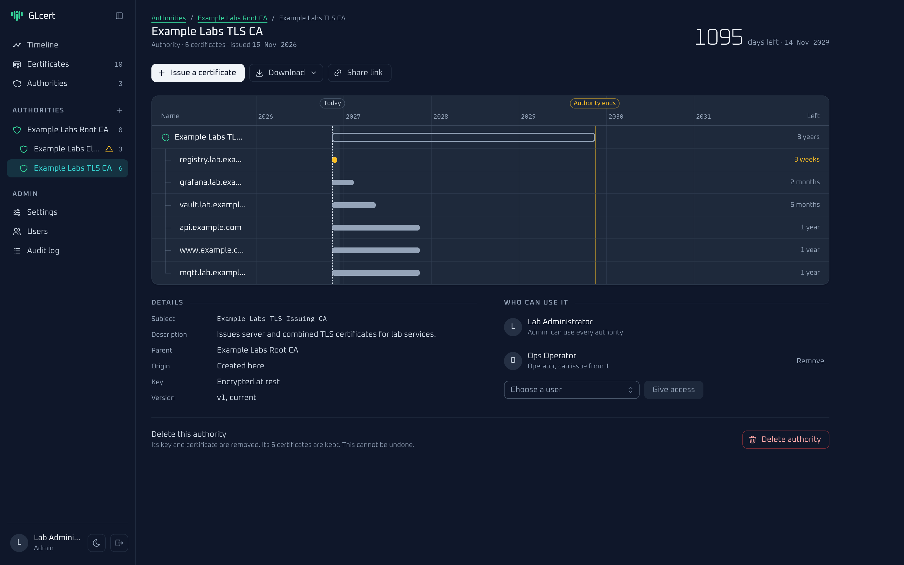
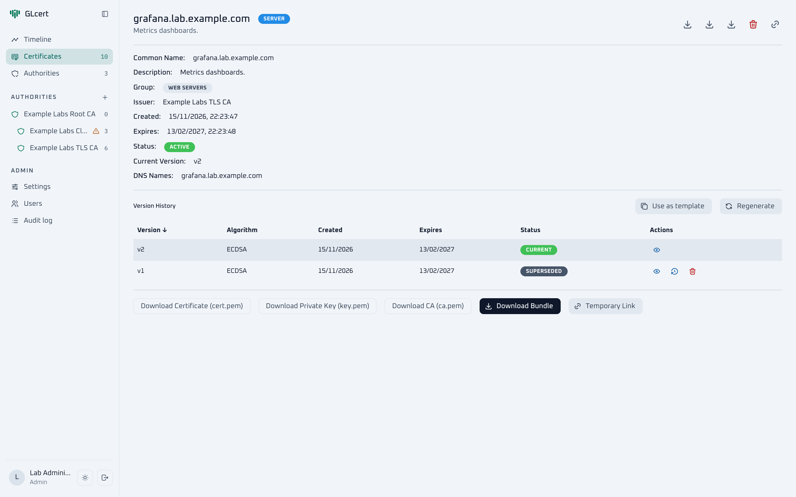
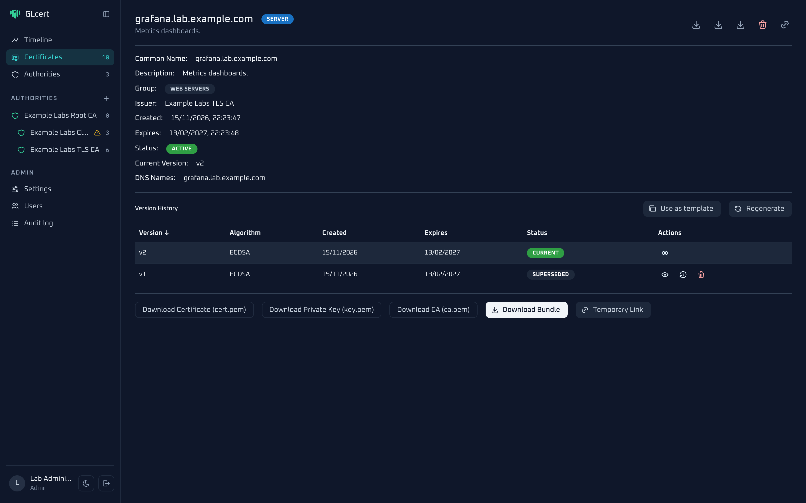
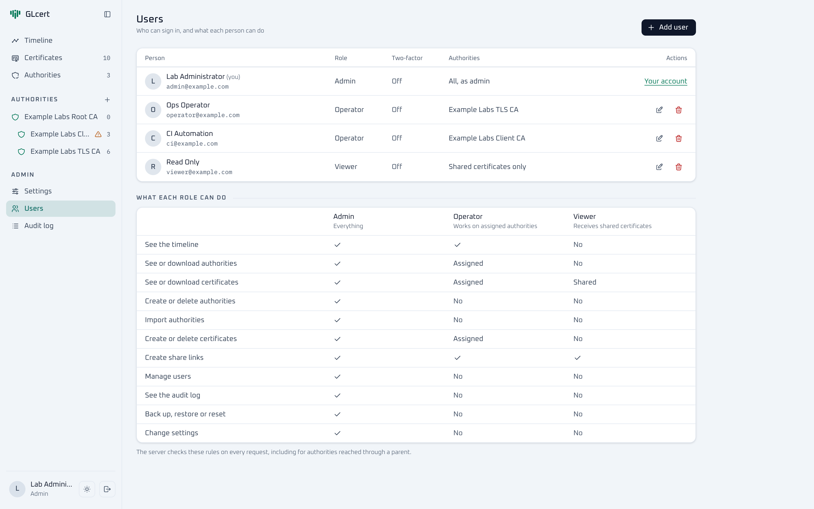
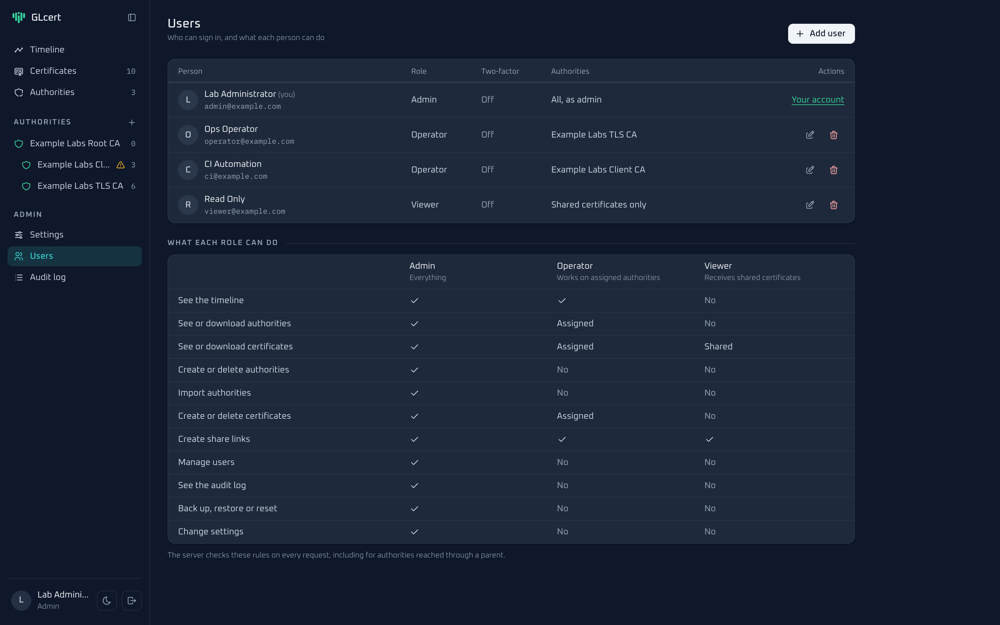
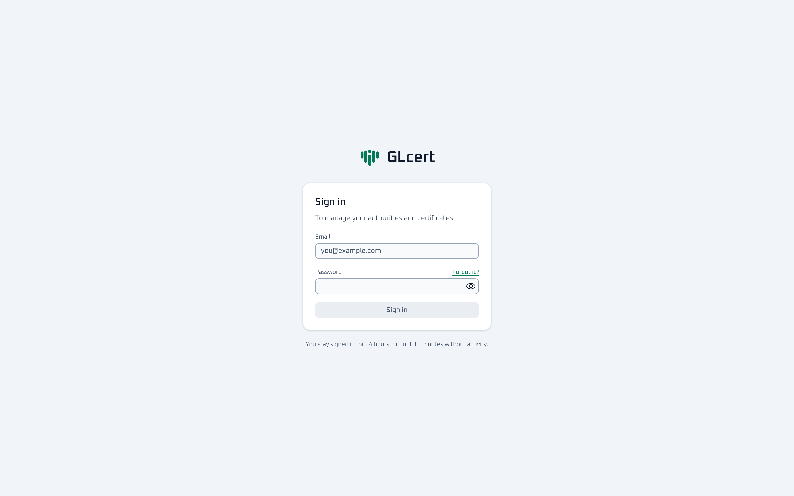
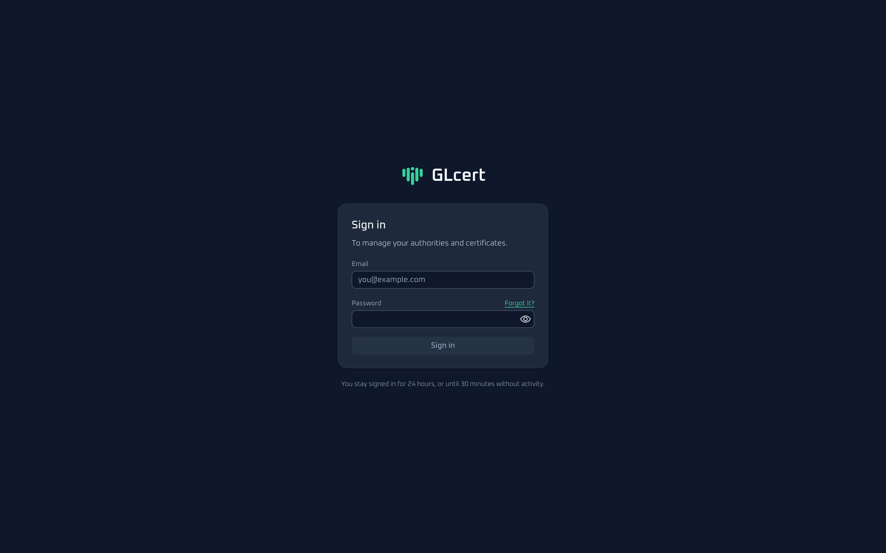

#   GLcert

Self-hosted PKI manager for lab and private environments. Create certificate authorities, issue and
manage TLS certificates, and control access from a web interface — without using OpenSSL.

> **Deployment note:** GLcert serves plain HTTP. Put it behind a TLS reverse proxy before using it
> across an untrusted network, and do not expose its application port directly to the internet.
> See the [security model](docs/SECURITY.md) for deployment assumptions and hardening steps.

## Screenshots

**Light and Dark theme**

| Dashboard | Certificate authorities |
|---|---|
| [](docs/images/dashboard-light.png) [](docs/images/dashboard.png) | [](docs/images/certificate-authorities-light.png) [](docs/images/certificate-authorities.png) |

| Certificate details | User administration |
|---|---|
| [](docs/images/certificate-details-light.png) [](docs/images/certificate-details.png) | [](docs/images/users-light.png) [](docs/images/users.png) |

| Sign in | |
|---|---|
| [](docs/images/login-light.png) | [](docs/images/login.png) |

## Features

- **Validity timeline:** The home screen puts every authority and certificate on one time axis
  (18 months or 6 years), with today and the 30-day alert window marked. Expiry is written out and
  coloured only when close, and the part of a certificate that outlives its authority is hatched.
  Pick a row to download, share, regenerate, or delete it from a details panel.
- **Certificate list:** Certificates grouped by authority, each with a validity bar, filterable by
  type, group, and name, with the same details panel and per-group bundle downloads.
- **Certificate authorities:** Create or import root and intermediate CAs with RSA, ECDSA, or
  Ed25519 keys. Manage parent-child chains and download certificates and private keys. Each
  authority's page shows its certificates on a timeline that marks where the authority ends, and
  lists who can use it.
- **Certificate lifecycle:** Issue server, client, combined, or self-signed certificates with
  RSA, ECDSA (P-256, P-384, P-521), or Ed25519 keys. Set validity periods, regenerate
  certificates (keeping their key algorithm), and restore earlier versions. The new-certificate
  form previews the validity against its authority and offers a fix when it would outlive it.
- **Role-based access:** Admin, Operator, and Viewer roles, with per-CA permissions enforced by
  the server.
- **Downloads and sharing:** Download individual files or ZIP/TGZ bundles. Create single-use,
  15-minute links for one file at a time, with a live countdown, ready-made wget and curl
  commands, and an email option (needs `PUBLIC_URL`).
- **Administration:** Manage users and the authorities each can use, review the audit log by
  kind, person and day, configure system settings, and back up, restore, or factory reset (asks
  for your password) from Settings.
- **Two-factor authentication:** Optional second factor after the password: passkeys
  (fingerprint, face, screen lock or a security key) and TOTP with encrypted secret storage. Both
  come with single-use backup codes and are managed from your account page, with a reminder after
  sign-in for accounts that use neither. Passkeys need a browser on HTTPS at the `PUBLIC_URL`
  address (or `http://localhost:<port>` when it is unset); in the desktop app they depend on the
  system web view and may not be offered.
- **Notifications:** Send CA and certificate expiration alerts through SMTP or supported webhook
  services. Configure a threshold and send a test notification.
- **Backup and restore:** Create password-encrypted ZIP backups. Restoring merges data without
  overwriting existing records.
- **Responsive interface:** A sidebar with your certificate authorities, their certificate counts,
  and a warning when a certificate outlives its authority. It folds into an icon rail on narrower
  windows and opens from a menu on phones. Dark, light, and system theme options.

## Quick start

### Docker Compose

With Docker Compose installed, run this from the repository root:

```sh
docker compose up -d --build
```

Open [http://localhost:8080](http://localhost:8080) and complete the setup wizard. Compose stores
application data in the persistent `glcert-data` volume, so the data survives container restarts.

### Local development

Prerequisites: Go 1.27+, Node.js 24+, and npm.

Start the backend:

```sh
cd backend
go mod download
go run ./cmd/server
```

The API is available at `http://localhost:18080`. In another terminal, start the frontend:

```sh
cd frontend
npm install
npm run dev
```

The frontend runs at `http://localhost:3000` and proxies API requests to the backend.

## Role permissions

| Action | Admin | Operator | Viewer |
|---|:---:|:---:|:---:|
| View dashboard | Yes | Yes | No |
| View or download CAs | Yes | Assigned CAs | No |
| View or download certificates | Yes | Assigned CAs | Shared certificates |
| Create or delete CAs | Yes | No | No |
| Import CAs | Yes | No | No |
| Create or delete certificates | Yes | Assigned CAs | No |
| Manage users | Yes | No | No |
| View audit log | Yes | No | No |
| Backup, restore, or factory reset | Yes | No | No |
| System settings | Yes | No | No |
| Create share links | Yes | Yes | Yes |

The server checks CA permissions on every operation. Access checks also follow the parent CA chain
when an operation addresses a child CA.

## Configuration

Configuration is layered, with values on the right taking precedence:

```text
defaults → config.json → .env → real environment variables
```

`config.json` is read from the working directory by default. Set `CONFIG_FILE` to load another
file. Invalid JSON, types, or values stop startup. The optional, gitignored `.env` file is loaded
next; malformed lines and unknown keys are skipped with a warning. Set `ENV_FILE` to load another
dotenv file. Real environment variables take precedence over both files.

| `config.json` key | Environment variable | Default | Description |
|---|---|---:|---|
| `port` | `PORT` | `18080` | HTTP server listen port |
| `dataDir` | `DATA_DIR` | `./data` | Database and certificate storage directory |
| `logLevel` | `LOG_LEVEL` | `info` | Log verbosity: `debug`, `info`, `warn`, `error`, or `fatal` |
| `publicUrl` | `PUBLIC_URL` | empty | Public `http(s)` origin used in emailed reset and share links, and the only address passkeys are accepted from; without it no such email is sent and passkeys work on `http://localhost:<port>` only |

| Loader variable | Default | Purpose |
|---|---|---|
| `CONFIG_FILE` | `./config.json` | Selects the JSON configuration file |
| `ENV_FILE` | `./.env` | Selects the dotenv file |

Docker Compose overrides the port to `8080` and stores data in `/data`.

## Notifications

Expiration notifications can be sent through SMTP or through [Shoutrrr-supported
services](https://shoutrrr.nickfedor.com/services/overview/), including Discord, Slack, Telegram,
and Gotify. Configure the destination and alert threshold in **Settings → Notifications**. You can
send a test notification from the same page.

GLcert also supports SMTP for password-reset, share-link, and expiration-alert email; reset and
share links are built from `PUBLIC_URL`. Treat webhook URLs and SMTP credentials as secrets; keep
them out of tracked files.

## Security

- Private keys are encrypted at rest under the setup encryption passphrase. Any admin sign-in
  unlocks them; until then operations stay locked. Restrict access to the data directory, which
  also contains the encryption key material.
- The database is not encrypted at rest, and the server uses plain HTTP. Use a TLS reverse proxy,
  protect the data directory, and keep encrypted backups in a separate secure location.
- Sessions expire after 24 hours and are cleared on server restart. Password changes invalidate
  all sessions.
- Two-factor authentication (passkeys and TOTP) is available for accounts. Share links are
  single-use and expire after 15 minutes.

Read [docs/SECURITY.md](docs/SECURITY.md) before deploying. It documents the security boundaries,
hardening checklist, and vulnerability reporting process.

## Project status

GLcert is maintained as a personal homelab project. There is no support service, response-time
commitment, release schedule, or compatibility guarantee. Issues and pull requests may go
unanswered. Forking and maintaining your own copy is encouraged; contributions are welcome on a
best-effort basis. See [CONTRIBUTING.md](CONTRIBUTING.md) for details.

## Documentation

- [Architecture](docs/architecture.md)
- [API reference](docs/api.md)
- [Database schema](docs/schema.md)
- [Security model](docs/SECURITY.md)
- [Changelog](docs/CHANGELOG.md)

## Tech stack

| Layer | Technology |
|---|---|
| Backend | Go 1.27, Chi, `crypto/x509` |
| Frontend | React 19, TypeScript, Mantine v9, Vite |
| Database | SQLite with a pure-Go driver (no CGO required) |
| Notifications | Shoutrrr |
| Deployment | Docker and Docker Compose |

## License

MIT — see [LICENSE](LICENSE).
